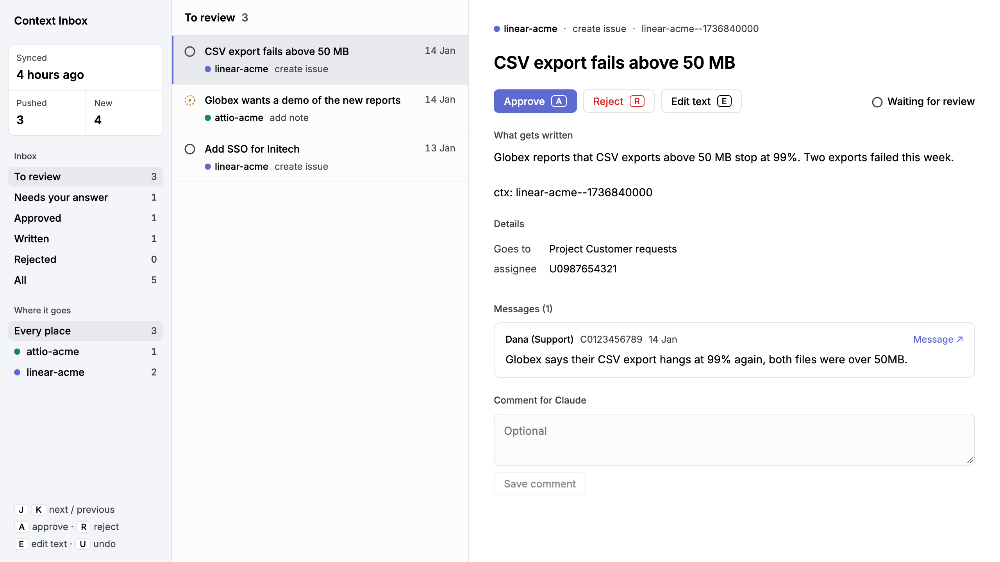
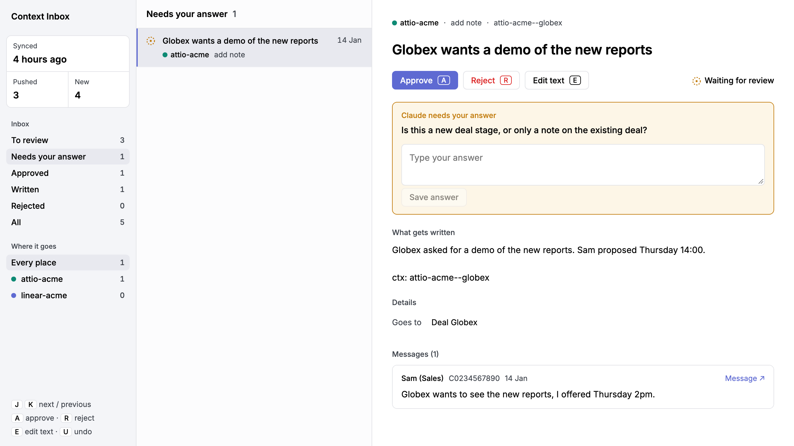
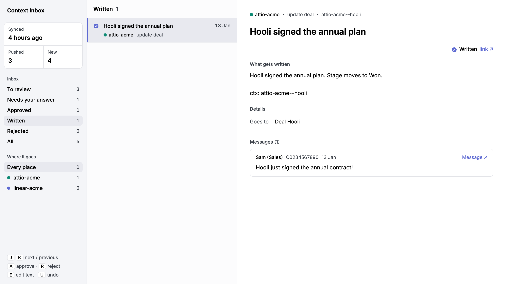
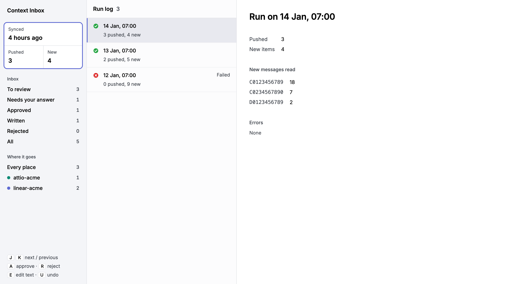

<p align="center"></p>

<p align="center">
  <b>Your team decides things in chat. Context Inbox gets them into your tracker, CRM and docs.<br>An agent drafts each update. You approve it before anything is written.</b>
</p>

<p align="center">
  <a href="#quickstart">Quickstart</a> ·
  <a href="#how-it-works">How it works</a> ·
  <a href="#integrations">Integrations</a> ·
  <a href="AGENTS.md">Agent instructions</a> ·
  <a href="CHANGELOG.md">Changelog</a>
</p>

<p align="center">
  
  
  
  
</p>

Bug reports, deal news and decisions land in chat. The tracker, the CRM and the docs fall behind, because nobody has time to copy things over.

Context Inbox does the copying. Every day an agent reads the new messages and drafts the updates they call for. Each draft waits on a review page with the exact text and the messages behind it. You approve, reject or edit. The next run writes only what you approved.



<p align="center"><sub>The review page. Each item shows the exact text it will write and the messages it came from.</sub></p>

## Highlights

- **Nothing is written without a yes.** Every update waits on the review page until a person approves it.
- **Every fact has a source.** Each draft quotes the messages behind it, with author, date and a link to the message.
- **No double writes.** Each written record carries a `ctx:` marker. The agent looks for it before writing, so a repeated run does not write the same record twice.
- **Late replies count.** Readers keep a cursor per channel and pick up new replies in threads of any age.
- **Personal talk stays out.** In channels marked private, the agent takes only work messages and skips the rest.
- **It asks when unsure.** The agent puts a question on the item. Your answer goes into the next run.
- **Works with your tools.** Slack, Linear, Attio and GitHub come built in. A new source takes a short reader. A new destination takes a guide of a few lines.
- **Set up by an agent.** A coding agent does the whole setup from [AGENTS.md](AGENTS.md). Manual setup works too.

## Quickstart

You need Claude Code, a claude.ai account and Python 3.10+.

Open this repo in a coding agent and tell it what to connect:

```text
Set up context-inbox for project "acme" following AGENTS.md.
Read #sales and #support in our Slack. Write deals to Attio and bugs to Linear.
```

The agent finds the channel IDs, picks a reader and a guide for each tool, checks the config, publishes the review page and runs once. Then it offers to schedule a daily run.

After that, your part is the review page. Approve what is right, and the next run writes it.

To set it up by hand, see [Manual setup](#manual-setup).

## How it works

```text
 Slack, email, ...          review page                 Linear, Attio, GitHub, ...
┌──────────────┐   draft   ┌──────────────┐   approved   ┌──────────────┐
│ new messages │ ────────▶ │  you decide  │ ───────────▶ │ next run     │
│ since cursor │  + quotes │ ✓  ✗  edit   │              │ writes once  │
└──────────────┘           └──────────────┘              └──────────────┘
```

1. A **reader** fetches messages newer than each channel's cursor.
2. The agent drafts **items** by the rules in your project's `RULES.md`, each with quotes and links.
3. You **review** them. When the agent is unsure, it asks a question, and your answer goes into the next run.
4. The next run **writes** the approved items, following the destination's **guide**, and saves a link to each record.

## The review page

Items wait here until someone decides. You answer the agent's questions, follow each written item to its record, and see what every run did.

<table>
  <tr>
    <td width="50%"><br><sub>The agent asks when it is unsure.</sub></td>
    <td width="50%"><br><sub>Written items link to the record and lock.</sub></td>
  </tr>
  <tr>
    <td width="50%"><br><sub>The run log shows what each run read, wrote and proposed.</sub></td>
    <td width="50%"><sub>Keys: <kbd>J</kbd> <kbd>K</kbd> move, <kbd>A</kbd> approve, <kbd>R</kbd> reject, <kbd>E</kbd> edit, <kbd>U</kbd> undo.<br><br>The screenshots use the made-up company Acme.</sub></td>
  </tr>
</table>

## Integrations

| | Built in | Recipes |
|---|---|---|
| **Sources** | [Slack](integrations/slack/reader.py) | [Slack to Linear](integrations/recipes.md) |
| **Destinations** | [Linear](integrations/linear/guide.md), [Attio](integrations/attio/guide.md), [GitHub](integrations/github/guide.md) | [Slack to Attio](integrations/recipes.md), [Slack to GitHub](integrations/recipes.md) |

**Adding a source** takes a small reader program, or plain instructions telling the agent to read through a connector it already has, such as Gmail. **Adding a destination** takes a guide of a few lines. Both live in your project folder. The formats are in [AGENTS.md](AGENTS.md).

## What's inside

| Part | What it does |
|---|---|
| [Connector](connector/check.py) | Finds your projects repo and checks every config. A mistake stops the run before it reads a message. |
| [Review page](ui/review.html) | Approve, reject, edit and answer. Filters by status and destination. Run log. |
| [Runner](runner/) | The daily prompt. [`fire.sh`](runner/fire.sh) starts a run from any agent or script. [`run.sh`](runner/run.sh) runs once while you watch. |
| [Agent instructions](AGENTS.md) | Setup and the daily run, step by step, plus the [proposal rules](RULES.md). |
| [Skills and hook](.claude/) | Claude Code skills for setup and run-now. A hook that refuses the destination writes it lists when they lack a `ctx:` marker, and any chat post. |
| [Example projects repo](projects-example/) | Acme: Slack to Linear and Slack to Attio. |

## Manual setup

You need [Claude Code](https://docs.claude.com/en/docs/claude-code) with a connector or CLI for each destination, a claude.ai account for the review page, and Python 3.10+.

1. **Make a project folder** in a private repo of its own, starting from [`projects-example/`](projects-example/). Edit `config.json` and `RULES.md`, then check them:
   ```sh
   python3 connector/check.py <projects repo> <project>
   ```
   A repo that holds a single project can keep `config.json` at its top level. Then pass the folder alone: `connector/check.py <project folder>`. The runner scripts accept the same.
2. **Publish [`ui/review.html`](ui/review.html).** Ask Claude Code to publish it as a claude.ai artifact with these capabilities, and put its URL in `review_page`:
   ```json
   { "user": { "scopes": ["profile"] }, "db": { "rules": [ { "path": "state", "read": "owner", "write": "owner" } ] } }
   ```
   Share it with your approvers as Contributor when the Share menu offers it, else as Editor. An Editor can also republish the page and read the saved cursors.
3. **Set each source token** in the env var named by its `secret`. The Slack reader needs a user token with `channels:history`, `groups:history`, `im:history`, `mpim:history` and `users:read`.
4. **Schedule it.** Copy [`runner/prompt.txt`](runner/prompt.txt), replace `<projects repo>/<project>` with your project folder, and save it as a Claude Code scheduled task with a daily cron. Start extra runs with:
   ```sh
   runner/fire.sh <projects repo> <project>   # no person needed
   runner/run.sh  <projects repo> <project>   # watch it run
   ```

<details>
<summary><b>Config reference</b></summary>

| Key | Meaning |
|---|---|
| `review_page` | URL of the published review page. |
| `routine` | Optional. Id of the scheduled task, such as `trig_01ABC`, so `runner/fire.sh` can start it. |
| `sources[].id` | Name for the source. Cursors are stored under it. |
| `sources[].type` | Name of the tool, such as `slack`. |
| `sources[].reader` | Integration name, such as `slack`, or a path inside the project folder. |
| `sources[].how` | Instructions for the agent to read through a connector instead. |
| `sources[].secret` | Env var that holds the token. |
| `sources[].channels[].id` | Exact channel ID, case-sensitive. Names like `#general` are not accepted. |
| `sources[].channels[].feeds` | Destination ids this channel may write to. |
| `sources[].channels[].private` | `true` for chats that mix work and personal talk. |
| `destinations[].type` | Name of the tool. The review page colours items by it. |
| `destinations[].guide` | Integration name, such as `attio`, or a path inside the project folder. |

Other keys on a destination, such as `team` or `repo`, are read by its guide. Other keys on a source or a channel are read by its reader. Keys are case-sensitive.

</details>

<details>
<summary><b>Repo layout</b></summary>

```text
AGENTS.md                instructions for the agent: setup and daily run
RULES.md                 what a proposal is and its JSON shape
connector/check.py       finds and checks project configs
integrations/            readers, guides, recipes
ui/review.html           review page and run log
runner/                  daily prompt, fire.sh, run.sh
.claude/                 skills and the write check
projects-example/        a projects repo to copy
scripts/release.sh       makes a release
```

</details>

## Contributing

Issues and pull requests are welcome. See [CONTRIBUTING.md](CONTRIBUTING.md), and report security problems as [SECURITY.md](SECURITY.md) describes.

- Keep this repo generic: no real company names, IDs, people or links. Those belong in a projects repo.
- Commit messages follow [Conventional Commits](https://www.conventionalcommits.org): `fix:` for a bug fix, `feat:` for a feature, `feat!:` for a change that breaks existing setups.
- Agents working on the repo should read "Changing this repo" in [AGENTS.md](AGENTS.md).

Versions follow [semantic versioning](https://semver.org). [release-please](https://github.com/googleapis/release-please) writes the [changelog](CHANGELOG.md) from the commit messages. `scripts/release.sh` opens the release pull request, and `scripts/release.sh publish` makes the release after it merges.

## License

[MIT](LICENSE)

The banner uses [Andromeda Galaxy (black background)](https://commons.wikimedia.org/wiki/File:Andromeda_Galaxy_(black_background).png) by Andrew Z. Colvin, [CC BY-SA 4.0](https://creativecommons.org/licenses/by-sa/4.0/). We cropped and blurred it and added text. The banner image (`docs/banner.jpg`) is shared under the same license.
